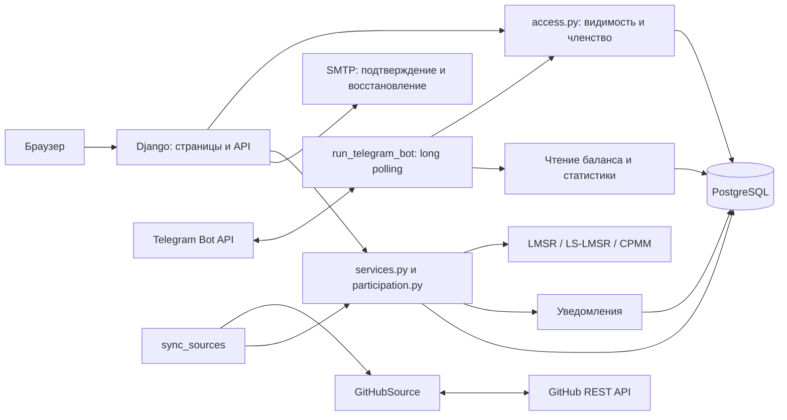
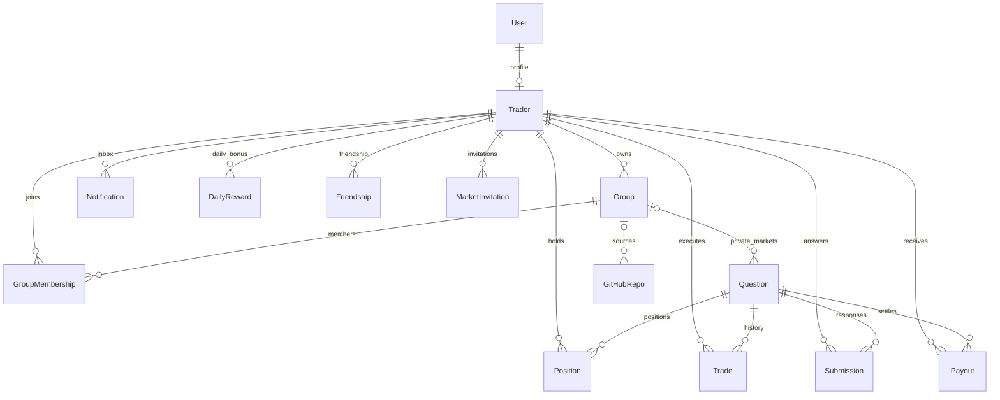
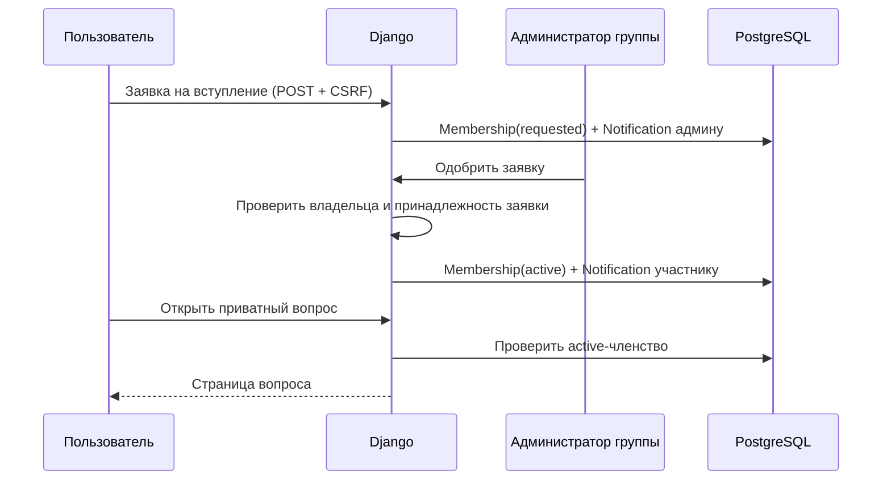
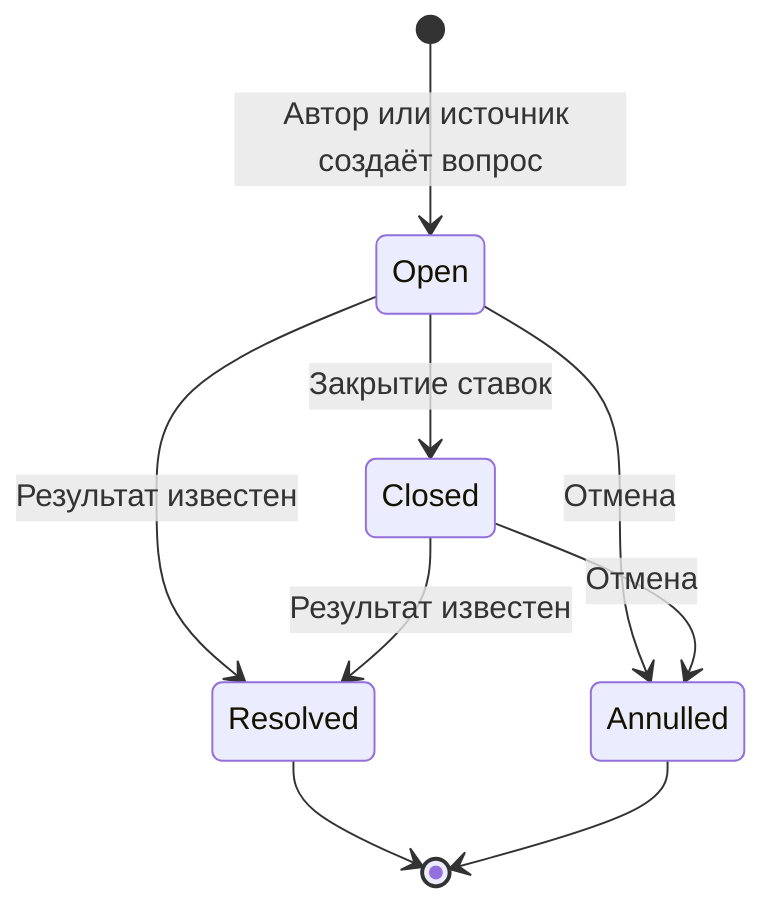
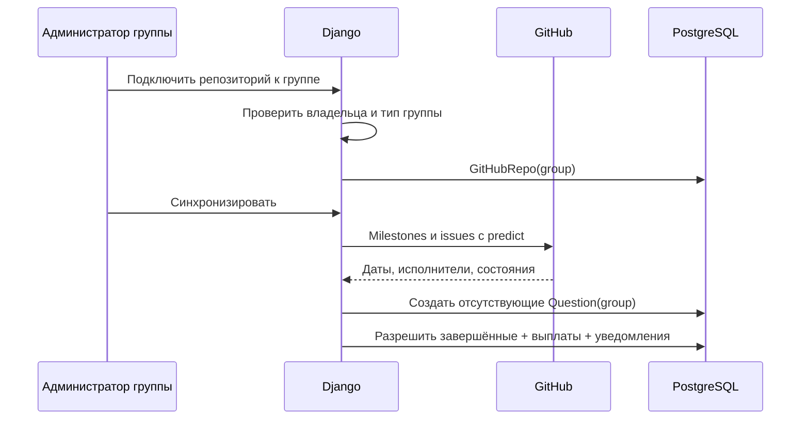
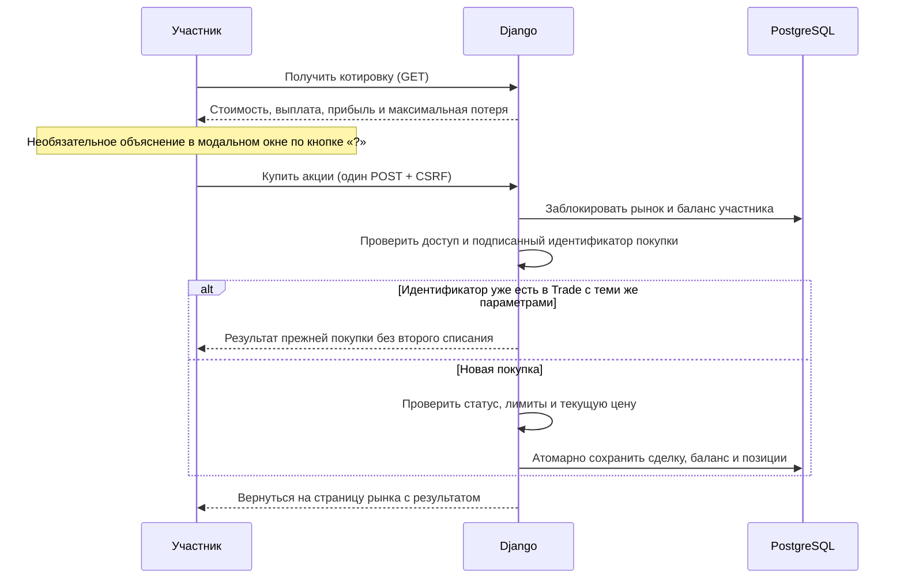

# Архитектура рынка прогнозов

## Компоненты

Приложение построено как модульный монолит Django. Веб-интерфейс и Telegram используют общую базу, профили и сервисы сделок. Сайт, бот и синхронизация запускаются отдельными процессами. PostgreSQL хранит рабочие данные; SQLite в памяти используется для изолированных тестов.

## Основные модули

| Модуль | Ответственность |
|---|---|
| `accounts`, `identity`, `forms` | Регистрация, профиль и связь Django User с Trader |
| `email_verification`, встроенные auth views | Подтверждение почты, восстановление пароля |
| `telegram`, `telegram_auth`, `bot_registration` | Привязка Telegram и одноразовый вход на сайт; в чате бот ведёт только в Mini App и `/my` |
| `services`, `mechanisms`, `lmsr` | Сделки, балансы, позиции, выплаты и математические модели |
| `participation` | Опросы, числа, множественные ответы и их результаты |
| `groups`, `access` | Членство, приглашения, заявки, приватность рынков |
| `friends`, `notifications` | Друзья, персональные приглашения, события и непрочитанные |
| `statistics`, `mascots`, `middleware` | Рейтинг, графики, опыт и ежедневный бонус |
| `group_analytics`, `subscriptions` | Панель рисков, историческая оценка прогнозов и подписки |
| `sources` | Адаптеры источников, идемпотентный импорт и автоматический резолв |
| `abmock` | Демонстрационный источник A/B-экспериментов |

## Данные

У Question без группы публичная видимость. Членство имеет состояния `requested`, `invited`, `active`; только `active` даёт доступ. Владелец группы — её администратор, создаётся с активным членством. Имена и описания групп доступны в поиске авторизованным пользователям; внутренние данные закрыты до вступления.

## Вступление в группу

## Жизненный цикл рынка

После дедлайна сервис не принимает сделки, даже если статус в базе ещё `open`; интерфейс показывает ожидание результата. Закрытый опрос уже считается завершённым: у него нет правильного ответа. При резолве торгового рынка выигравшая акция выплачивает одну монету. Изменение статуса, выплаты и уведомления выполняются в одной транзакции. Повторное разрешение блокируется.

## GitHub внутри рабочей группы

Идентификатор источника включает группу: `ghg<id>:owner/repo:issue:<number>`. Поэтому один репозиторий можно подключить к двум группам без смешивания рынков. Для общих рынков сохранён префикс `gh`. Серверный токен не используется для группового репозитория до отдельного одобрения администратором сайта.

## Границы доступа и целостность

- `visible_questions(trader)` используется для списка, карточки, API, котировки, формы ставки, приглашений, Telegram и личного списка позиций. Чужая прямая ссылка возвращает 404.
- Сервис сделок дополнительно проверяет членство, чтобы внутренний вызов не обходил правила веб-слоя.
- В личных уведомлениях приватные вопросы скрываются после выхода из группы. Приглашения в приватные вопросы разрешены только друзьям с активным членством.
- Балансы меняются внутри `transaction.atomic()` с блокировкой участников и рынка; финансовые значения хранятся в Decimal.
- Уникальные ограничения защищают от повторных членств, приглашений, ежедневных бонусов и повторного импорта источников.
- Ежедневные 5 монет и 2 XP начисляются один раз по дате Москвы. Монеты учитываются отдельно и исключены из прибыли.
- POST защищены CSRF. Ссылки Telegram одноразовые, срок действия 10 минут, токен передаётся во фрагменте URL и затем в POST. Страницы подтверждения используют `Referrer-Policy: same-origin` и `Cache-Control: no-store`.
- Ключи и пароли читаются из окружения, `.env` не хранится в Git. Для публикации на сервере требуются отдельные production-настройки, HTTPS и резервное копирование PostgreSQL.

## Покупка и объяснение расчёта

`Trade.request_key` уникален в БД. Серверный ключ формы подписан и связан с участником и вопросом; повтор ключа с другой суммой или стороной отклоняется. Новая форма получает новый ключ и позволяет докупить те же акции на ту же сумму. Старые подтверждения сохраняют прежнюю одноразовую семантику. `Position.yes_spent` и `no_spent` хранят стоимость непроданных акций соответствующей стороны, `spent` — их сумму. Продажа уменьшает только стоимость своей стороны с округлением списанной стоимости вниз до копеек.

Подписчик получает результат без обязательной позиции. Изменения торговой вероятности уведомляются при накопленном сдвиге от 10 п.п. и часовом ограничении частоты. `MarketSubscription` уникальна по вопросу и участнику. Панель рисков учитывает только явно обозначенные вопросы выполнения к сроку. Отчёт использует срез истории до исхода; текущая цена завершённого рынка не подменяет прошлый прогноз.
